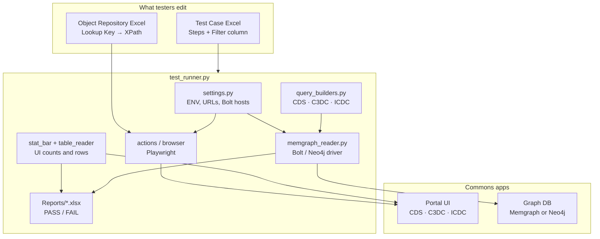
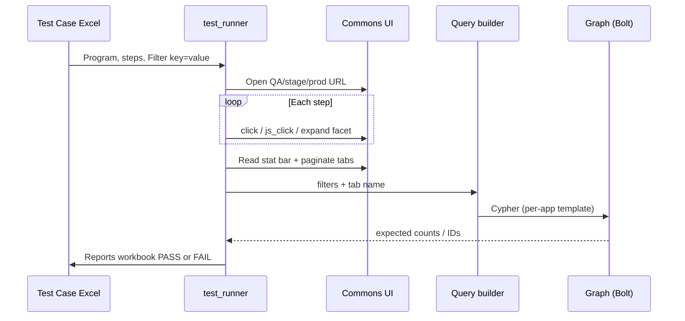

# Commons Playwright Framework

Python + Playwright automation for CBIIT NCI Data Commons portals.

Excel-driven, environment-agnostic, and designed so testers add cases without changing Python. Migrated from Katalon Studio: same object paths and step style, new runner and per-app Cypher comparison.

---

## Architecture

Testers own **Excel**. The runner owns **browser + graph compare**. URLs, locators, and Cypher templates never live in test steps.



### Runtime flow (one test case)



| Layer | Responsibility | Code |
|--------|----------------|------|
| Test case | What to click and which filters to apply | `TestCases/**/*.xlsx` |
| Object repository | `{Program}/{Page}/{Object}` → XPath | `ObjectRepository/<Program>_ObjectRepository.xlsx` |
| Config | URLs and DB endpoints; no URLs in Excel | `config/settings.py`, `.env` |
| Orchestrator | Execute steps, collect filters, compare | `tests/test_runner.py` |
| UI | Playwright clicks, tables, stat bar | `core/actions.py`, `core/stat_bar.py`, `core/table_reader.py` |
| Expected data | Per-app Cypher from the Filter column | `core/query_builder_cds.py`, `query_builder_c3dc.py`, `query_builder_icdc.py` |
| Graph | CDS/C3DC = Memgraph; ICDC = Neo4j | `core/memgraph_reader.py` |

**Rule:** one program = one object repo + one query builder + one Bolt cluster. CDS must not query the ICDC graph, and ICDC must not query the CDS Memgraph NLB.

---

## Why this exists

| Katalon (legacy) | Commons Playwright |
|------------------|--------------------|
| Groovy scripts per TC | One runner; Excel is the script |
| Object Repository `.rs` trees | Per-program Excel, same lookup keys |
| CDS: Memgraph; ICDC: TSV / Neo4j mix | Same compare path: UI vs live graph |
| Hard to run headless / CI | `HEADLESS`, `ENV`, suite runner |

Testers still write Katalon-style steps. Engineers own locators, Cypher templates, and environment wiring.

---

## Programs

| Program | Portal (QA) | Expected data | Result tabs |
|---------|-------------|---------------|-------------|
| **CDS** | [general-qa.datacommons.cancer.gov](https://general-qa.datacommons.cancer.gov) | Memgraph | Participants, Samples, Files |
| **C3DC** | [clinicalcommons-qa.ccdi.cancer.gov](https://clinicalcommons-qa.ccdi.cancer.gov) | Memgraph (C3DC cluster) | Participants, Studies, Diagnosis, Samples |
| **ICDC** | [caninecommons-qa.cancer.gov](https://caninecommons-qa.cancer.gov) | Neo4j | Cases, Samples, Case Files, Study Files |
| **CTDC** | [clinical.datacommons.cancer.gov](https://clinical.datacommons.cancer.gov) | Object repo present | Wiring in progress |

ICDC was stored as **Canine** in Katalon. This repo uses **ICDC** everywhere (OR keys, Program column, runner). `Canine` still resolves as an alias.

---

## How a tester writes a case

Every workbook has a **Steps** sheet.

**Row 2 — config**

| Program | Input Excel | Max Pages |
|---------|-------------|-----------|
| `ICDC` | `InputFiles/ICDC/TC01_….xlsx` | `2` |

**Row 3+ — steps**

| Action | Page | Object Name | Params | Filter |
|--------|------|-------------|--------|--------|
| `dismiss_popup` | | | | |
| `click_and_wait` | `NavBar` | `Canine_Cases_Btn` | | |
| `js_click_and_wait` | `Filter` | `Study/UC01_Chkbx` | | `study=UC01` |
| `js_click_and_wait` | `Filter` | `StudyType/…Genomics_Chkbx` | | `study_type=Genomics` |
| `read_stat_bar` | | | `ICDC` | |
| `multi_function` | | | `CasesTab` | |

The runner builds `ICDC/Filter/Study/UC01_Chkbx`, looks it up in the object repo, and later sends `{study: [UC01], study_type: [Genomics]}` to the ICDC query builder.

Optional **Queries** sheet: Tab name + full Cypher override (used when a template is not enough).

---

## Demo: run a test

From the `Commons_playwright` repo root. First time only:

```bash
pip install playwright openpyxl neo4j python-dotenv
playwright install chromium
```

Put Bolt passwords in gitignored `.env` (`MEMGRAPH_PASSWORD_*`, `NEO4J_PASSWORD_ICDC`).

**ICDC (headed — good for a live demo)**

```bash
HEADLESS=false ENV=qa python3 -c "
from tests.test_runner import run_test_from_excel
run_test_from_excel('TestCases/ICDC/UC01/TC01_ICDC_UC01_StudyType-Genomics.xlsx')
"
```

**C3DC**

```bash
HEADLESS=false ENV=qa python3 -c "
from tests.test_runner import run_test_from_excel
run_test_from_excel('TestCases/C3DC/TC01_C3DC_phs000463_SexAtBirth-Female.xlsx')
"
```

**CDS**

```bash
HEADLESS=false ENV=qa python3 -c "
from tests.test_runner import run_test_from_excel
run_test_from_excel('TestCases/TC01_CDS_phs001437_Sex-Unknown_ExperimentalStrategy-RNASeq.xlsx')
"
```

**Suite slice**

```bash
python3 -m tests.run_suite --dir TestCases/ICDC
python3 -m tests.run_suite --dir TestCases/C3DC --filter phs000463
```

| Variable | Default | Meaning |
|----------|---------|---------|
| `ENV` | `qa` | `qa`, `stage`, or `prod` |
| `HEADLESS` | `true` | `false` to watch the browser |
| `BROWSER` | `chromium` | `chromium`, `firefox`, `webkit` |

Reports land in `Reports/`. Each run writes a workbook with filters, UI vs graph stat bar, and per-tab PASS/FAIL.

---

## Repository map

```
Commons_playwright/
├── config/settings.py                 # URLs + per-app Bolt config
├── core/
│   ├── object_repo.py                 # find_test_object(lookup_key)
│   ├── actions.py / browser.py
│   ├── stat_bar.py / table_reader.py
│   ├── memgraph_reader.py             # Neo4j driver (Memgraph + Neo4j)
│   ├── query_builders.py              # dispatch by program
│   ├── query_builder_cds.py
│   ├── query_builder_c3dc.py
│   └── query_builder_icdc.py
├── tests/
│   ├── test_runner.py                 # single TC
│   └── run_suite.py                   # batch
├── ObjectRepository/
│   ├── CDS_ObjectRepository.xlsx
│   ├── C3DC_ObjectRepository.xlsx
│   ├── ICDC_ObjectRepository.xlsx
│   └── CTDC_ObjectRepository.xlsx
├── TestCases/
│   ├── TC##_CDS_*.xlsx
│   ├── C3DC/
│   └── ICDC/<study>/
├── tools/
│   ├── import_katalon_or.py
│   ├── import_commons_or.py           # C3DC YAML
│   ├── import_icdc_or.py
│   ├── build_c3dc_testcases.py
│   └── build_icdc_testcases.py
└── Reports/                           # generated (gitignored)
```

---

## Refresh locators or generate cases

| Task | Command |
|------|---------|
| Import CDS/CTDC from Katalon `.rs` | `python3 tools/import_katalon_or.py CDS "../Commons_Automation/Object Repository/CDS"` |
| Import C3DC from pytest YAML | `python3 tools/import_commons_or.py C3DC ../commons-automation/ObjectRepository/C3DC` |
| Import ICDC (Katalon Canine + YAML overlay) | `python3 tools/import_icdc_or.py` |
| Rebuild C3DC sample Excels | `python3 tools/build_c3dc_testcases.py` |
| Rebuild ICDC TC01–TC07 per study | `python3 tools/build_icdc_testcases.py` |

---

## Add a new program

1. Capture page URLs and add them under `_BASE_URLS` / `_PAGE_PATHS` in `config/settings.py`.
2. Import or create `ObjectRepository/<Program>_ObjectRepository.xlsx`.
3. Add `PROGRAM_TABS` and facet expanders in `tests/test_runner.py`.
4. Add `core/query_builder_<app>.py` and register it in `query_builders.py`.
5. Point `get_memgraph_config` at that app’s Bolt cluster.
6. Add Excel TCs under `TestCases/`.

---

## Common actions

| Action | Use |
|--------|-----|
| `dismiss_popup` | First step on every case |
| `click_and_wait` | Nav and facet headers |
| `js_click_and_wait` | MUI checkboxes |
| `read_stat_bar` | Params = program (`CDS`, `C3DC`, `ICDC`) |
| `multi_function` | Params = tab (`CasesTab`, `ParticipantsTab`, …) |
| `navigate_to` | Page name from settings (no raw URL) |
| `login` | Params = `email,password` |

---

## Talking points for a demo

1. **Open an Excel TC** — show Program, Filter column, and that there is no URL in the file.
2. **Open the matching object repo** — show `ICDC/NavBar/Canine_Cases_Btn` → XPath.
3. **Run headed** — banner dismiss, Explore, study + facet, stat bar, four tabs.
4. **Show the report** — UI counts next to graph counts; tab PASS/FAIL.
5. **Call out isolation** — CDS Memgraph, C3DC Memgraph, ICDC Neo4j are separate.
